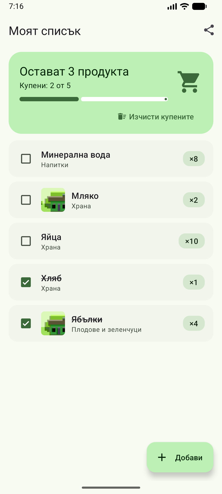
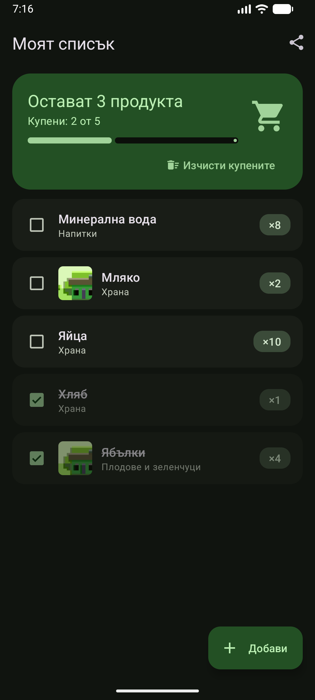

# ShopList – списък за пазаруване

**Проект по дисциплината „Мобилни приложения“** · ФН 2401321052


## Идея

**ShopList** е Android приложение за списък за пазаруване. Потребителят добавя продукти с количество, категория и снимка, отмята купените и вижда колко още остават. Всички данни се пазят в локална база на телефона, затова приложението работи и **без интернет**.

## Как работи

При стартиране се отваря списъкът с продуктите. Отгоре има карта, която показва колко продукта остават и лента с прогреса. Бутонът **„Добави“** отваря формата, където се въвеждат име, количество и категория (с бързи бутони като „Храна“ и „Напитки“). По желание продуктът може да се снима с камерата. Формата проверява данните: празно име или количество 0 показват грешка. Натискане на продукт отваря същата форма за редакция. Отметката маркира продукта като купен, а плъзгане встрани го изтрива с възможност за „Отмени“. Бутонът **„Изчисти купените“** изтрива всички купени след потвърждение. Иконата за **споделяне** изпраща некупените продукти като текст към друго приложение. Данните се записват в Room и остават след рестарт. Поддържа се светъл и тъмен режим.

## Архитектура

Приложението следва **MVVM** с **Repository** слой:

```
Фрагменти (UI)  →  ShoppingViewModel  →  ShoppingRepository  →  Room (SQLite)
       ↑                                                              │
       └──────────────────── LiveData (автоматично обновяване) ───────┘
```

| Слой | Файлове | Отговорност |
|---|---|---|
| **UI** | `ItemListFragment`, `AddEditItemFragment`, `ShoppingAdapter` | Показват данните и приемат действията на потребителя |
| **ViewModel** | `ShoppingViewModel`, `ItemValidator`, `ListSummary` | CRUD логика, валидация, оцелява при завъртане |
| **Repository** | `ShoppingRepository`, `RoomShoppingRepository` | Единствен вход към данните |
| **Данни** | `ShoppingItem` (`@Entity`), `ShoppingItemDao` (`@Dao`), `AppDatabase` (`@Database`) | Room база, версия 2 с миграция |
| **DI** | `ShopListApplication` (`AppContainer`) | Създава базата и Repository-то веднъж (ръчен DI) |

Пример – записът минава през ViewModel-а в корутина:

```kotlin
viewModelScope.launch {
    if (existing == null) repository.insert(item) else repository.update(item)
}
```

### Допълнителни функционалности

- **Camera Intent** – `ActivityResultContracts.TakePicture()` отваря камерата, а `FileProvider` ѝ дава достъп само до един файл. Пътят до снимката се пази в Room (колона `photoPath`, добавена с миграция 1 → 2).
- **Share Intent** – `ACTION_SEND` с тип `text/plain` изпраща некупените продукти към Viber, Gmail, SMS и др.

Приложението **не изисква permissions**: снимането и споделянето се извършват от други приложения чрез Intent.

## Потребителски поток

1. Отваряне на приложението → списък с продуктите и карта с прогреса
2. **Добави** → попълване на име, количество, категория → (по желание) **Снимай продукта** → **Запази**
3. Продуктът се появява в списъка
4. Натискане на продукт → редакция → **Запази**
5. Отметка → продуктът е купен (зачертан); прогресът се обновява
6. Плъзгане встрани → изтриване → (по желание) **Отмени**
7. **Изчисти купените** → потвърждение → купените се изтриват
8. **Споделяне** → избор на приложение → изпращане на некупените продукти

## Стъпки за стартиране

**Изисквания:** Android Studio (последна версия), Android SDK 37, устройство или емулатор с Android 7.0 (API 24) или по-нов.

1. Клониране на репото:
   ```bash
   git clone https://github.com/Yusein194/MobileApps2026--2401321052-.git
   ```
2. Отваряне на папката в Android Studio и изчакване на Gradle Sync.
3. Стартиране с **Run ▶** върху емулатор или устройство.

Или директно инсталиране на готовия APK: [`apk/app-release.apk`](apk/app-release.apk).

Полезни команди:

| Команда | Какво прави |
|---|---|
| `./gradlew assembleDebug` | Компилира debug APK |
| `./gradlew testDebugUnitTest` | Пуска unit тестовете |
| `./gradlew connectedAndroidTest` | Пуска Espresso теста (нужен е емулатор) |
| `./gradlew ktlintCheck detekt` | Проверява стила и качеството на кода |
| `./gradlew assembleRelease` | Създава подписан release APK |

## Тестови акаунти

Не са необходими. Приложението няма регистрация и вход – всички данни са локални на устройството.

## Скрийншоти

| Светъл режим | Тъмен режим |
|---|---|
|  |  |

## APK

Готовият подписан APK е в [`apk/app-release.apk`](apk/app-release.apk) (около 6.9 MB).

## Тестове и качество на кода

- **22 unit теста** (JUnit) за валидацията, текста за споделяне, прогреса и CRUD операциите във ViewModel-а с фалшиво repository – **21% покритие** на редовете
- **1 UI тест** (Espresso): добавяне на продукт и проверка, че се появява в списъка
- **ktlint** и **detekt** без грешки
- **LeakCanary** в debug версията – без memory leaks в кода на приложението
- **GitHub Actions** при всеки push: проверка на стила, unit тестове и компилиране на APK

## Технологии

| Технология | Версия |
|---|---|
| Kotlin | вграден в AGP 9 |
| Android Gradle Plugin | 9.4.1 |
| Min SDK / Target SDK | 24 / 37 |
| Room | 2.8.5 |
| Navigation Component | 2.9.8 |
| Lifecycle (ViewModel, LiveData) | 2.11.0 |
| Material Components (Material 3) | 1.14.0 |
| Coil | 2.7.0 |
| KSP | 2.3.12 |
| JUnit / Espresso | 4.13.2 / 3.7.0 |
| ktlint / detekt | 1.5.0 / 1.23.8 |
| LeakCanary | 2.14 |
